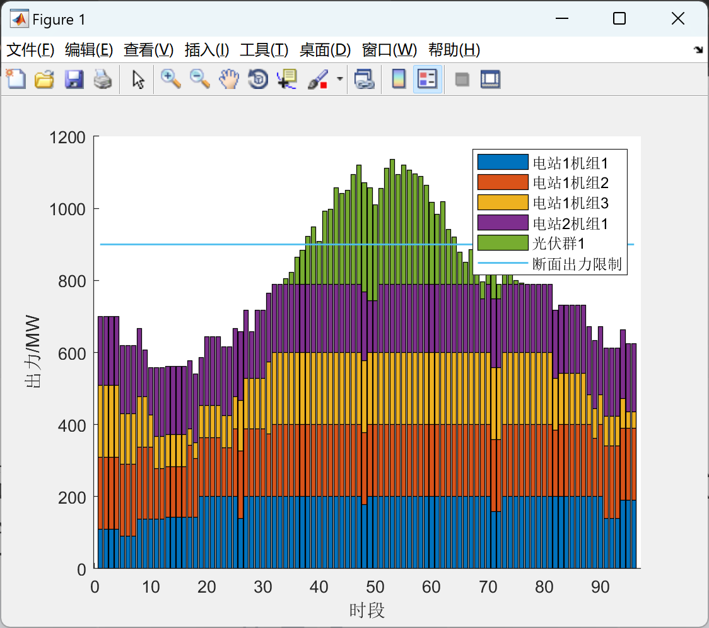
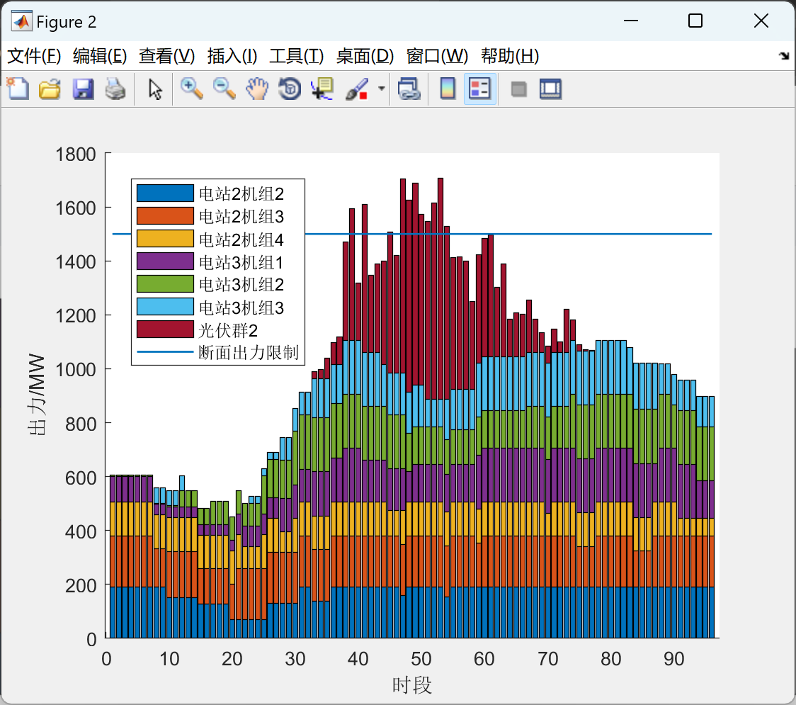
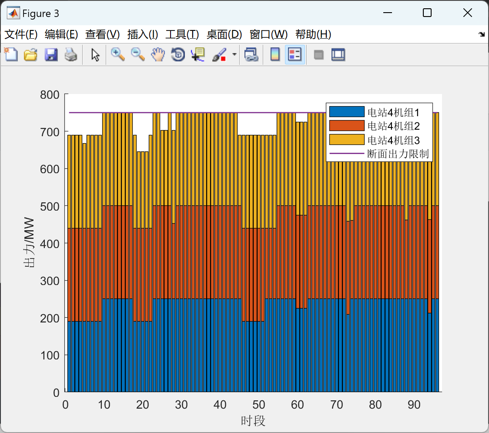
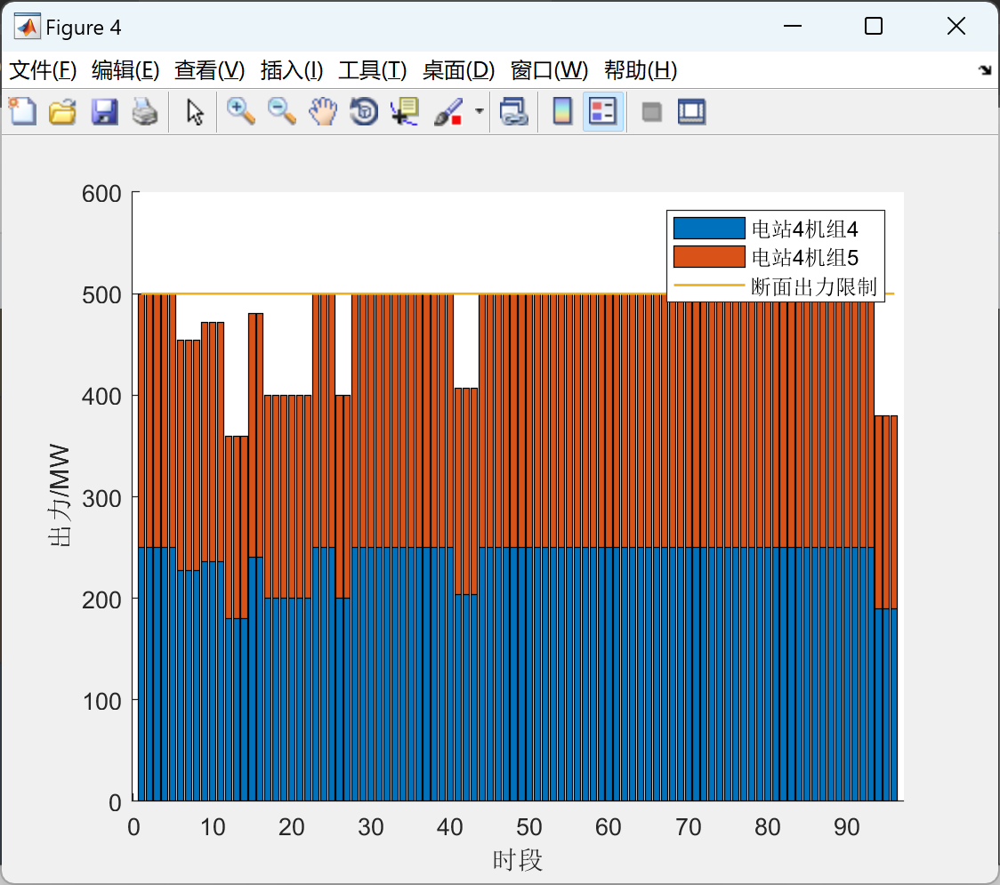

# [EI Reproduced] Step-level Water and Light Complementary System with Maximum Absorbable Electricity Expectation Short-term Optimized Scheduling Model (Matlab Code Implementation)

[EI Reproduced] Maximum Absorptive Electricity Capacity Optimization Model for Tier-Level Photovoltaic-Photothermal Complementary Systems (Matlab Code Implementation)

## Images

<!-- PAYMENT_BLOCK -->

## Get this dataset

- Payment link (Stripe): [Buy now](https://buy.stripe.com/3cs8yP7sY87d0vu9AB)
- Payment QR code: 

<!-- /PAYMENT_BLOCK -->
